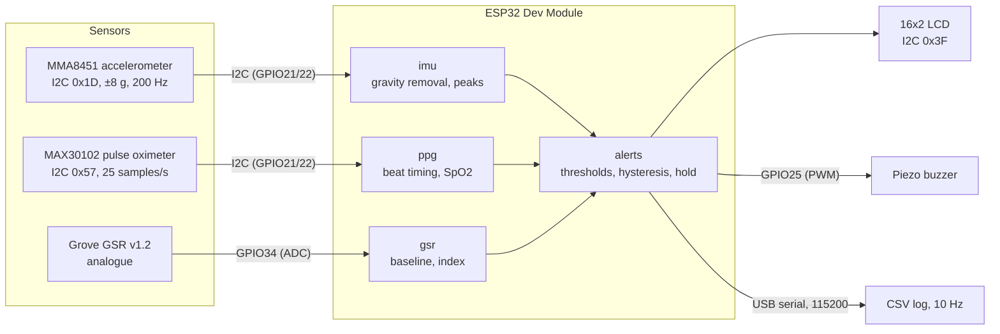

# Racing Driver Helmet Biometric Monitor

An ESP32-based prototype that sits in a racing driver's helmet and watches three things at once: the g-forces on the head, the driver's heart rate and blood oxygen, and skin conductance as a rough indicator of arousal. It shows the readings on a small LCD, sounds a graded alarm when a threshold is crossed, and streams everything as CSV over serial for later analysis.

The idea was inspired by the driver monitoring used in Formula 1. This is a student engineering project, not a product: see [Limitations](#limitations).

> **Project status.** The firmware builds cleanly for the ESP32. The code in this repository is a restructured and corrected version of the original single-file sketch (kept in [`archive/`](archive/)), and **the restructured firmware has not yet been run on the hardware**. The unit tests compile for the target but **have not yet been executed**. [`docs/review.md`](docs/review.md) lists every change and how to verify each one on the bench.

## Key features

- **G-force** from an MMA8451 accelerometer read at its full 200 Hz output rate, with gravity removed by an orientation-independent estimator, split into lateral, longitudinal and vertical components, with session-peak tracking and clipping detection.
- **Heart rate and SpO2** from a MAX30102 optical sensor: beat-to-beat heart rate for a fast response, and the Maxim reference algorithm for SpO2 on a rolling 4 s window.
- **GSR arousal index** from a Grove GSR sensor, expressed relative to a baseline taken during a 5 s calibration.
- **Three alert levels** (WARNING, DANGER, CRITICAL) with hysteresis and a minimum hold time, so a 20 ms spike is still seen and logged, and a value sitting on a threshold does not flicker.
- **Non-blocking firmware.** One cooperative loop with no `delay()` after start-up; the buzzer patterns are a small state machine.
- **Testable core.** The alert rules, gravity estimator, heart-rate averaging, GSR index, buzzer sequencing and LCD formatting are plain C++ with no hardware dependencies, with 87 unit tests.
- **Sensor fault reporting.** A sensor that is missing or stops responding is shown as such on the LCD and flagged in the log, instead of being reported as a healthy zero.

## System overview



## Hardware

| Part | Role |
|---|---|
| ESP32 Dev Module (NodeMCU-32S) | Controller |
| Adafruit MMA8451 breakout | 3-axis accelerometer, 14-bit, ±8 g |
| MAX30102 breakout | Red/IR photoplethysmography (heart rate, SpO2) |
| Seeed Grove GSR sensor v1.2 | Skin conductance |
| 16x2 character LCD with I2C backpack | Display |
| Passive piezo buzzer | Audible alerts |

### Wiring

| Component | VCC | GND | SDA | SCL | Other |
|---|---|---|---|---|---|
| LCD (I2C backpack) | 3V3 | GND | GPIO21 | GPIO22 | |
| MMA8451 | 3V3 | GND | GPIO21 | GPIO22 | |
| MAX30102 | 3V3 | GND | GPIO21 | GPIO22 | |
| Grove GSR v1.2 | 3V3 | GND | | | SIG to GPIO34 |
| Piezo buzzer | | GND | | | + to GPIO25 |

| I2C device | Address |
|---|---|
| LCD | `0x3F` (use `0x27` if the display stays blank) |
| MMA8451 | `0x1D` |
| MAX30102 | `0x57` |

All pins, addresses, rates and thresholds live in [`src/config.h`](src/config.h).

## How each measurement is computed

### G-force

The accelerometer is read 200 times a second. A stationary accelerometer reads 1 g pointing upwards, in whatever orientation it is in, so that part has to be removed before the number means "acceleration of the head".

The original sketch subtracted 1 g from the sensor's Z axis, which is only right while the helmet is perfectly level. This version estimates the gravity vector instead:

1. During the 5 s start-up calibration the mean reading is taken as the initial gravity vector.
2. Afterwards the estimate follows the reading through a low-pass filter (1 s time constant), **but only while the reading's magnitude is within 0.15 g of 1 g**. In a hard corner or under braking the magnitude is far above 1 g, the filter is frozen, and the load is not mistaken for a change in head position.
3. Dynamic acceleration = reading − gravity estimate. Its magnitude is `g_total`.

The dynamic vector is then split into components. "Up" is the gravity direction; "forward" is a configured hint (sensor Y by default, as in the original) projected onto the horizontal plane; "lateral" is perpendicular to both.

With a single accelerometer and no gyroscope this cannot be exact: a head tilt that happens *during* a long corner is not seen until the load comes off. The error is bounded by the tilt (a 30° change is about 0.5 g), which is well below the 2.5 g warning threshold.

The alert logic uses the largest value seen since its previous run, so a peak between two 20 ms alert ticks is not missed.

### Heart rate

The MAX30102 is configured for 100 Hz conversions with 4× averaging, so 25 samples per second come out of its FIFO. Each IR sample goes through the SparkFun library's beat detector. When a beat is found, the interval since the previous beat gives an instantaneous rate; rates outside 20–220 bpm are discarded, and the last four are averaged.

Beat intervals are measured by counting samples (each one is exactly 40 ms after the last by the sensor's own clock), not with `millis()`, so the result does not depend on how promptly the main loop reads the FIFO.

### SpO2

The Maxim reference algorithm (as shipped in the SparkFun library) runs once a second on the most recent 100 samples (4 s) of red and IR data. Results the algorithm marks invalid, or outside 50–100 %, are ignored. The algorithm also produces its own heart-rate estimate; that is logged as `hr_maxim_bpm` for comparison but is not displayed or used for alerts.

Heart rate and SpO2 are blanked when skin contact is lost (IR level with hysteresis and debounce) and when they have not updated for 5 s and 10 s respectively.

### GSR arousal index

The GSR input is read as calibrated millivolts (eight conversions averaged, 50 times a second). The mean over the 5 s calibration is the baseline, and

```
index = 100 × (reading − baseline) / (full scale − baseline)     clamped to 0..100
```

This is a relative measure of electrodermal activity. It is not a stress measurement, has no unit, and cannot be compared between people or sessions. The original sketch called it a "stress index"; it has been renamed for that reason.

**Open item:** which direction of the signal corresponds to higher arousal on this sensor has not been confirmed on the bench (see [review, issue 6c](docs/review.md#6c-polarity-of-the-gsr-signal-unverified)). The direction is a one-line switch in `config.h`.

## Alert logic

| Level | G-force (dynamic) | GSR arousal index | Heart rate |
|---|---|---|---|
| WARNING | ≥ 2.5 g | ≥ 60 | |
| DANGER | ≥ 4.0 g | ≥ 80 | > 180 bpm, or < 40 bpm |
| CRITICAL | ≥ 6.0 g | | |

The alert level is the highest level any one measurement reaches. A heart rate of 0 means "no reading" and never alerts.

On top of the thresholds:

- **Hysteresis.** A level is released only when the value has moved back past the threshold by a margin (0.3 g, 5 index points, 5 bpm).
- **Hold.** Once raised, a level stays shown, logged and sounded for at least 3 s after its cause has gone.
- **Optional latch.** `ALERT_LATCH_CRITICAL` keeps a CRITICAL alert until it is acknowledged. It is off by default because the hardware has no button; alerts can be acknowledged over serial (`a`) or with an optional button (`PIN_ACK_BUTTON`).

**Buzzer patterns** (repeating at most once a second while the alert lasts; a more severe alert interrupts immediately):

| Level | Pattern |
|---|---|
| WARNING | one 150 ms beep at 800 Hz |
| DANGER | two 100 ms beeps at 1200 Hz |
| CRITICAL | three 80 ms beeps at 2000 Hz |

## LCD pages

Pages rotate every 3 seconds. While the alert level is DANGER or CRITICAL the display locks to the g-force page.

| Page | Line 1 | Line 2 |
|---|---|---|
| Heart (shown first) | `HR:  72 bpm     ` | `SpO2:   97 %    ` |
| GSR | `Arousal:  42%   ` | `GSR mV:  1650   ` |
| G-force | `G: 1.2 Pk: 3.4  ` | `Lat 4.2 DNGR G  ` |

On the last line, the letters after the alert level say what raised it: `G` g-force, `S` skin conductance, `H` heart rate. Missing readings are shown as `---` and missing sensors as `no sensor`.

## Serial output

115200 baud. Lines beginning with `#` are status messages. Everything else is CSV, with one header line and then ten rows per second:

| Column | Meaning |
|---|---|
| `time_ms` | Milliseconds since power-on |
| `g_total` | Dynamic acceleration magnitude, latest sample (g) |
| `g_lat` | Lateral component, absolute value (g) |
| `g_long` | Longitudinal component, absolute value (g) |
| `g_peak_session` | Largest `g_total` since start-up or the last reset (g) |
| `gsr_index` | GSR arousal index, 0–100 |
| `gsr_mv` | GSR reading in millivolts (`gsr_raw` if built for raw ADC counts) |
| `hr_bpm` | Heart rate; 0 = no reading |
| `spo2_pct` | SpO2; 0 = no reading |
| `alert` | 0 none, 1 warning, 2 danger, 3 critical (after hold/latch) |
| `g_peak_window` | Largest `g_total` since the previous row (g) |
| `g_vert` | Vertical component, signed (g) |
| `hr_maxim_bpm` | Heart rate from the Maxim window algorithm; diagnostic |
| `alert_instant` | Alert level before hold/latch |
| `alert_sources` | Bit flags: 1 g-force, 2 GSR, 4 heart rate |
| `status` | Bit flags: 1 accelerometer OK, 2 pulse sensor OK, 4 GSR OK, 8 skin contact, 16 accelerometer clipped since previous row, 32 calibrating |

The first ten columns are in the same order as the original sketch's log.

Single-character commands can be typed into the serial monitor:

| Key | Action |
|---|---|
| `a` | Acknowledge (clear) a held or latched alert |
| `r` | Reset the session peak g |
| `c` | Rerun the 5 s calibration |
| `h` | List the commands |

## Build, flash, monitor

The project uses [PlatformIO](https://platformio.org/). Platform and library versions are pinned in [`platformio.ini`](platformio.ini).

```sh
pio run                  # build
pio run -t upload        # flash over USB
pio device monitor       # serial output, 115200 baud
```

At power-on, keep the helmet still with the GSR electrodes on for the 5 second calibration.

### Unit tests

```sh
pio test -e native       # runs on your PC; needs a host C++ compiler (g++ or clang++)
```

The tests cover only the hardware-independent code in [`src/core/`](src/core/). They can also be built for, and run on, the ESP32 itself with `pio test -e esp32dev`.

### Plotting a log

```sh
pio device monitor --quiet > session.csv
python tools/plot_log.py session.csv -o session.png
```

The script prints a summary using only the Python standard library and draws the plot if matplotlib is installed.

## Repository layout

```
src/
  main.cpp            scheduler: what runs when
  config.h            pins, addresses, rates, thresholds, behaviour switches
  telemetry.h         the shared data record
  imu.*               MMA8451 driver glue
  ppg.*               MAX30102 driver glue
  gsr.*               GSR ADC reading
  display.*           LCD pages
  buzzer.*            PWM output for the piezo
  logger.*            CSV output and serial commands
  core/               hardware-independent logic (unit tested)
    alerts.*            thresholds, hysteresis, hold/latch
    gravity.*           gravity estimator, axis projection
    ppg_logic.*         beat averaging, contact detection
    gsr_index.*         arousal index, baseline tracking
    buzzer_pattern.*    non-blocking tone sequencing
    lcd_format.*        16-character line formatting
test/                 Unity tests for src/core/
tools/plot_log.py     summarise and plot a captured log
docs/review.md        code review: every issue found, what changed, how to verify
archive/              the original single-file sketch, for reference
```

## Limitations

- **Not a medical device and not a safety device.** Nothing here is validated, certified or suitable for making decisions about a person's health or safety. It must not be relied on in any vehicle.
- **Not yet verified on hardware** in its current form, as noted at the top.
- **Accelerometer range.** The MMA8451 measures up to ±8 g per axis. That covers cornering and braking loads but is far below the accelerations of a crash, so this cannot measure impacts; the CRITICAL threshold of 6 g is already close to the top of the range. Readings that clip are flagged in the log.
- **Gravity removal without a gyroscope** is approximate, as described above.
- **Optical heart rate on the head while moving.** The sensor, driver library and algorithms were designed for a still fingertip. On a forehead or temple inside a vibrating helmet, motion artefacts will corrupt the signal, and the contact thresholds have not been tuned for that placement. At 25 samples per second, beat timing is quantised to 40 ms, which is roughly ±12 % at 180 bpm before averaging. SpO2 from the reference algorithm is indicative only.
- **GSR interpretation.** Skin conductance rises with sweat for any reason, including heat and exertion, both of which are guaranteed inside a helmet. The index shows change from a baseline, not stress. The signal direction is unconfirmed (see above).
- **Thresholds** are the original project's values and have not been validated against real driving data.

## Future work

- Bench verification against the checklist in `docs/review.md`, then real logged sessions.
- A high-g accelerometer (for example an ADXL375, ±200 g) alongside the MMA8451 for impact detection, and an IMU with a gyroscope for proper orientation tracking.
- Use the MMA8451's FIFO and its built-in transient detection with an interrupt, so no sample is ever missed.
- Run the optical sensor at 100 samples per second for beat detection (decimated to 25 for the SpO2 algorithm) and add accelerometer-based motion rejection.
- On-board logging to SD card or a wireless link in place of the USB cable.
- A hardware acknowledge button and an alert for sensor faults.

## Author

**Lord Monasterial**

Contributors: `<team members>`

## Licence

MIT, see [LICENSE](LICENSE).
